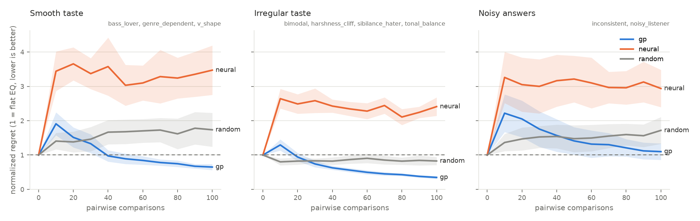

# tasteq

**An open-source equalizer that learns *your* sound.** Compare two versions of a
song, say which one you prefer, and tasteq uses Bayesian preference optimization
to converge on your ideal 10-band EQ, conditioned on the kind of music you are
playing.

[](https://github.com/Rafawaldrigues/tasteq/actions/workflows/ci.yml)
[](LICENSE)


> **Status:** active development. The DSP core, three preference models, the
> simulated-listener benchmark, the calibrate/listen CLI and the browser demo
> work; a human blind test is next. See the [roadmap](#roadmap).

## Why

Tuning an EQ by hand is tedious and does not follow the music. Existing tools
either run a one-off static test (Sonarworks SoundID), are paid and
platform-locked (EQK), or target producers (iQ / Ear Machine). tasteq is
**open source, keeps learning from everyday feedback, and is evaluated
rigorously**.

## How it works

1. **Analyze** a local music folder: features and a representative excerpt per
   track, cached.
2. **Calibrate** with ~10 diverse tracks and 3–5 A/B comparisons each.
3. **Listen and learn**: tracks play with the predicted best EQ; 👍/👎 and
   occasional A/B tests keep refining the model.

Two rules keep the learning honest:

- **AI controls the EQ, never the audio.** The audio path is deterministic DSP
  (biquad filters); the model only chooses 10 gains in [-10, +10] dB.
- **Louder never wins.** Every version is normalized to −23 LUFS (±0.5 LU) with
  true peak ≤ −1 dBTP, verified by property-based tests for any EQ in range.

Design decisions and their trade-offs are in [docs/design.md](docs/design.md).

## Results

Before asking real people, every model is tested against nine simulated
listeners ("personas") with a hidden taste and a noisy way of answering A/B
questions. Some tastes are smooth and easy to model (bass lover, smile curve);
others are deliberately hard: asymmetric, bimodal, a ridge of equally good
curves, a cliff where any presence boost above +3 dB is rejected, or a listener
who answers at random a quarter of the time. Each model gets 100 comparisons,
10 seeds per persona, with common random numbers across models.

The metric is **normalized regret** of the recommended EQ: 0 is the listener's
true optimum, 1 is no better than leaving the EQ flat.



| after 100 comparisons | preference GP | neural ensemble | random search |
|---|---|---|---|
| smooth taste (3 personas) | **0.65** ± 0.09 | 3.47 ± 0.72 | 1.73 ± 0.49 |
| irregular taste (4) | **0.35** ± 0.04 | 2.41 ± 0.27 | 0.83 ± 0.12 |
| noisy answers (2) | **1.10** ± 0.24 | 2.94 ± 0.54 | 1.72 ± 0.39 |
| runs better than flat | **75 / 90** | 9 / 90 | 41 / 90 |

Mean ± 95% CI over seeds. Per-persona curves:
[regret](docs/figures/regret_per_persona.png),
[held-out accuracy](docs/figures/accuracy_per_persona.png); full table with
"comparisons to reach 50% / 80% of the possible gain" in
[docs/benchmark.md](docs/benchmark.md).

What the numbers say:

- **The preference GP is the only model that reliably improves on flat.** On
  sibilance and tonal-balance tastes it captures 50% of the possible gain in
  20–25 comparisons, which fits inside one calibration session.
- **Early recommendations are worse than flat** for every model that explores
  (regret above 1 at 10 comparisons). The GP crosses below flat after 20–40
  comparisons on smooth and irregular tastes; until then, playing the flat EQ
  would be the safer default.
- **Noise is the hard part, not taste shape.** The noisy listener and the
  context-dependent persona (whose taste flips between kinds of track) stay
  near or above flat after 100 comparisons.

### Why a GP and not just a neural network

The neural Bradley–Terry ensemble *does* learn: it ranks held-out pairs with
0.61 accuracy against the GP's 0.66. But its recommendations end up clearly
**worse than flat** (regret 2.4–3.5). Our reading: with a few dozen noisy
answers an MLP extrapolates confidently, and five bootstrap members agree with
each other far more than the data justifies, so the uncertainty that should
keep it near what the listener has heard collapses. The GP's posterior variance grows away from the
data by construction, and that is exactly what a recommender working from tens
of labels needs. A neural model becomes interesting with a prior pooled
across many users (see the roadmap), not for one person's cold start.

Reproduce with `tasteq bench --config configs/main.yaml` (about 3–4 h on 16
CPU threads; resumable). These figures come from a run that straddled two
commits differing only in how the recommendation search is seeded. A
single-commit rerun is planned before the technical report.

## Quickstart

```bash
pip install -e ".[ml,audio]"
tasteq analyze ~/Music              # one-time analysis, cached in ~/.tasteq/tasteq.sqlite
tasteq calibrate                    # ~10 diverse tracks x 4 A/B questions
tasteq listen                       # whole tracks with your EQ; + / - while playing
```

### Try it in the browser

```bash
pip install -e ".[ml,audio,demo]"
tasteq demo --synthetic             # generated tracks, no music needed
tasteq demo                         # your analyzed library
```

The demo plays two loudness-matched versions of an excerpt in random order and
asks which one you prefer. Next to them, the EQ the model would play for that
track updates after every answer, with a shaded band for how unsure it still
is. Answers go to the same database as the CLI, so calibrating in the browser
and listening in the terminal share one model.

No music handy? `tasteq demo-library ./demo-music` writes synthetic,
copyright-free tracks to try it with. `tasteq show` prints the learned EQ per
track, and `tasteq bench --config configs/main.yaml` reproduces the
simulated-listener benchmark.

Local playback uses PortAudio when installed and otherwise a system player
(`pw-play`, `paplay`, `aplay` or `ffplay`).

## Roadmap

Planned for this repository:

- [x] Loudness-matched EQ rendering with property-based tests
- [x] Simulated listeners + preference models (random, preference GP, neural
      Bradley–Terry ensemble) + reproducible benchmark
- [x] Benchmark results and figures in this README
- [x] Track analysis and context features
- [x] Calibration and listen-and-learn CLI
- [x] Interactive Gradio demo with a live EQ curve and uncertainty band
- [ ] Blind test, technical report

Longer term (not implemented here):

1. Dynamic EQ per section, using look-ahead from the pre-analysis
2. Long-term listening profile (how often you play something ≠ wanting it louder)
3. Per-instrument control via source separation ("more vocals, less hi-hat")
4. Real-time system-wide EQ and an Android app
5. A prior learned from many users for the cold start

## Development

```bash
python -m venv .venv && source .venv/bin/activate
pip install -e ".[dev,ml,audio]"
pytest
```

## License

MIT. The repository contains no copyrighted music; tests use synthetic audio.
