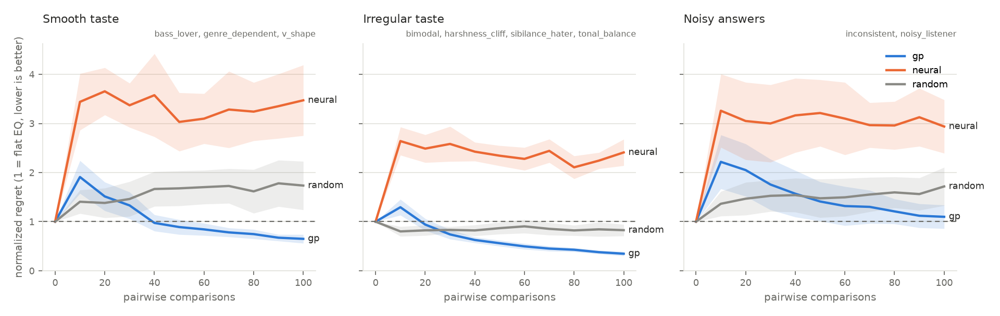
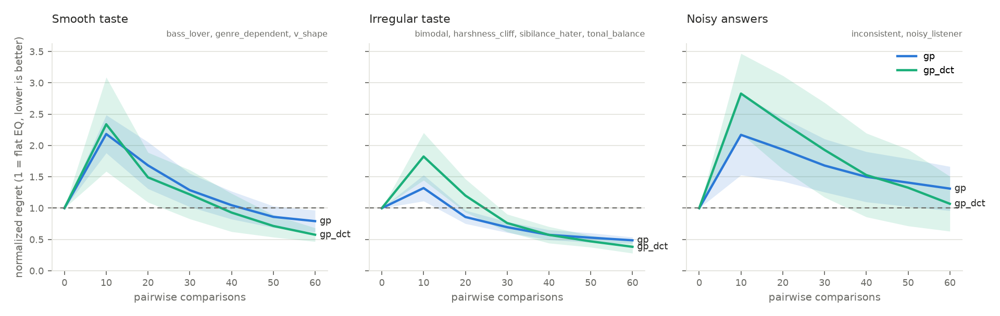

# tasteq: learning a personal EQ from pairwise comparisons

*Technical report.* It covers the problem, the method, how it was evaluated,
what the results show and what they do not. Design rationale is in
[design.md](design.md); the full benchmark table is in
[benchmark.md](benchmark.md).

## 1. Problem

Find, for one listener, the 10-band EQ curve `x ∈ [−10, 10]^10` dB that
maximizes an unknown utility `u(x, c)`, where `c` describes the track. The
only feedback is a noisy answer to "which of these two versions do you
prefer?", and a person will give a few dozen of those, not thousands.

Three constraints shape everything that follows:

1. **Very few labels.** Calibration should take one sitting: about 40
   comparisons.
2. **Comparisons, not ratings.** People are inconsistent at absolute scores
   but fairly reliable at A/B choices, so the data are pairwise preferences
   (with "no difference" allowed).
3. **Louder wins.** In any A/B test of audio, the louder version tends to be
   preferred. If EQ changes loudness, a learner will simply learn "louder".

This is *preferential Bayesian optimization* (PBO) with a small budget and
side information (the track context).

## 2. System

### 2.1 Audio path: deterministic DSP, verified loudness

The model never touches audio. It outputs 10 gains; a fixed filter bank
applies them:

- RBJ biquads: low shelf at 31 Hz, high shelf at 16 kHz, peaking filters
  (Q = 1.2) at 62 Hz to 8 kHz, cascaded as second-order sections.
- Every rendering is normalized to **−23 LUFS** (ITU-R BS.1770 via
  `pyloudnorm`) with true peak **≤ −1 dBTP** (4× oversampled), using a
  lookahead limiter only as a safety net.

The low target leaves headroom for +10 dB boosts, so the limiter rarely engages
and normalization does not fight limiting. Property-based tests (`hypothesis`)
check, for arbitrary gain vectors in range and several signal families
(noise, tones, impulsive drums), that any two renderings are within
**0.5 LU** of each other and never exceed the true-peak ceiling. They also
check that the filter's measured response matches its analytic response.

*Known limitation:* LUFS is a K-weighted energy measure, not a perceptual
loudness model. A bass-heavy and a bright curve matched in LUFS can still
differ slightly in perceived loudness. This bias is reduced, not removed.

### 2.2 Search space

Gains map linearly to the unit cube `[0, 1]^10` (flat EQ = 0.5). An optional
smooth basis maps a 5-D latent to the 10 gains through DCT-II components over
band index. That is a prior that adjacent bands move together; whether it
helps is tested in §4.5.

Pairs are proposed inside an **adaptive trust region** around the current
best guess. Its half-width runs from ±1 dB to ±5 dB and is set by:

- **Uncertainty:** the model's posterior std at its best point relative to
  the std far from the data. High uncertainty means larger steps.
- **Failures:** the region shrinks by 0.7× for each consecutive time the
  incumbent beats the challenger, as in TuRBO. A "no difference" answer ends
  the streak instead of extending it, because it means the step was
  inaudible, not too large.

### 2.3 Preference models

All models share one interface (`update`, `predict → (mean, std)`,
`suggest_pair`, `best`) and are rebuilt by replaying the comparison log, so any
of them can be swapped in or recomputed from the database.

| model | utility | uncertainty | next challenger |
|---|---|---|---|
| **random** | none (hill climber) | none | uniform in the trust region |
| **gp** | BoTorch `PairwiseGP`, Laplace approximation | posterior | EUBO (expected utility of the best option) vs. the incumbent |
| **neural** | 5 MLPs (64 hidden, SiLU), Bradley–Terry loss | bootstrap ensemble | Thompson sampling |

GP details:

- **Kernel:** additive in the context, `k_x + k_x·k_c`, so a shared taste
  is learned fast and a track-dependent correction grows only with data.
- **Ties:** dropped from the likelihood, since `PairwiseGP` models strict
  preferences only.

Neural details:

- **Labels and weights:** ties are soft labels of 0.5, and comparisons from
  👍/👎 carry half weight.
- **Regularization:** AdamW plus a small Gaussian prior on utilities.
- **Centering:** each member is centered on its training-data mean, because a
  Bradley–Terry utility is only defined up to a constant.

**Recommendation.** The EQ that plays is not the acquisition's choice. It is
the point maximizing a **lower confidence bound** (mean − 1·std), searched
only within ±1 dB of settings that have won at least once (or flat). A
recommendation therefore never extrapolates into a region the listener has
not heard. This rule was added after the first benchmark runs: an optimistic
argmax let every model recommend EQs worse than flat.

### 2.4 Context

Each track is analyzed once:

- **Features:** Welch band energies, spectral centroid and rolloff, tempo
  and RMS dynamic range.
- **Context vector:** the features are standardized, reduced by PCA to at
  most 4 dimensions and min–max scaled to `[0, 1]`.
- **Excerpt:** a representative 12 s window is chosen whose band-energy
  profile is closest to the whole track's, skipping quiet intros.

Calibration picks about 10 tracks by farthest-point sampling in context space,
so the first questions span the library's range of sounds.

### 2.5 Interfaces and persistence

A `Tuner` object owns the model, the library and the log. Every front end goes
through it, so all of them behave the same:

- **CLI:** `calibrate`, `listen` and `blindtest`.
- **Gradio demo:** A/B buttons, a live EQ curve with an uncertainty band, and
  a blind-test tab.

The `Tuner` also handles randomizing which version plays first and writing
every answer to SQLite, together with:

- the points and the gains actually played;
- the context, the excerpt and the presentation order;
- the weight and the source (A/B or 👍/👎).

👍/👎 during whole-track listening become comparisons *against flat on the
same track*, at half weight, because a thumbs-down may be about the song
rather than the EQ.

## 3. Evaluation design

### 3.1 Simulated listeners

A model that only ever meets smooth, unimodal tastes is being tested on the
GP's home ground. The nine personas are therefore split by what they test:

| group | persona | hidden utility |
|---|---|---|
| smooth taste | bass_lover, v_shape | quadratic around a target curve |
| | genre_dependent | target moves from bass-heavy to vocal-forward with `c` |
| irregular taste | sibilance_hater | asymmetric: boosting 4–8 kHz past the target costs 2× |
| | tonal_balance | only the bass–treble tilt matters: a ridge, not a peak |
| | bimodal | max of two quadratics (bass-heavy or bright) |
| | harshness_cliff | mild quadratic with a −4 step if any of 2–8 kHz exceeds +3 dB |
| noisy answers | noisy_listener | smile curve, choice temperature 3× |
| | inconsistent | bass lover answering at random 25% of the time |

Answers follow a Bradley–Terry choice model, `P(A) = σ(Δu / T)`, with a lapse
rate and a "no difference" zone (|Δu| < 0.15).

### 3.2 Metrics and protocol

- **Normalized simple regret** of the recommended EQ:
  `(u* − u(x̂)) / (u* − u(flat))`. 0 = the persona's optimum (found by
  multi-start L-BFGS-B), 1 = no better than flat, above 1 = worse than flat.
- **Comparisons to reach 50% / 80%** of the achievable gain over flat.
- **Held-out pairwise accuracy:** agreement with the persona's noiseless
  preference on 300 fixed pairs within ±5 dB of flat.
- **Protocol:**
  - 100 comparisons per run, evaluated every 10, across 10 tracks and
    6 evaluation contexts;
  - 10 seeds per persona × model;
  - the same random numbers for every model given a persona and seed;
  - mean ± 95% CI over seeds.

## 4. Results

### 4.1 Overview



| after 100 comparisons | gp | neural | random |
|---|---|---|---|
| smooth taste | **0.65** ± 0.09 | 3.47 ± 0.72 | 1.73 ± 0.49 |
| irregular taste | **0.35** ± 0.04 | 2.41 ± 0.27 | 0.83 ± 0.12 |
| noisy answers | **1.10** ± 0.24 | 2.94 ± 0.54 | 1.72 ± 0.39 |
| runs better than flat | **75 / 90** | 9 / 90 | 41 / 90 |
| held-out accuracy (mean) | 0.66 | 0.61 | 0.67 |

### 4.2 The preference GP

The GP is the only model that improves on flat reliably:

- **Overall:** regret falls steadily after the first 10 comparisons on every
  persona.
- **Fast cases:** on sibilance_hater and tonal_balance it reaches 50% of the
  possible gain in a median of 20–25 comparisons, in 10 of 10 seeds, which
  fits within one calibration session.
- **bass_lover:** 9 of 10 seeds reach 50% (median 40 comparisons) and 3 reach
  80%.

### 4.3 Early recommendations are worse than flat

At 10 comparisons, regret is **above 1** for the GP in every persona group, for
example 1.9 on the smooth group. The trust region steps ±5 dB at first, and
with a handful of answers the best-known winner is often just the less bad of
two strong EQs. The GP needs 20–40 comparisons before its recommendation beats
flat.

Practical consequence: **an interface should keep playing flat until the model
is confident.** A simple rule would be to switch only once the LCB of the
recommendation exceeds the LCB of flat. The demo states it plainly instead
("recommendations get reliable after ~30").

### 4.4 Where the GP struggles

- **genre_dependent (1.16 ± 0.24):** the optimum moves with the context. With
  10 comparisons per track and an additive kernel that learns the
  context-dependent part only slowly, 100 comparisons are not enough. This is
  the cost of the "shared taste first" prior; it is the right trade-off for a
  cold start but visibly limits context-heavy tastes.
- **noisy_listener (1.44 ± 0.35):** with a choice temperature 3× higher, each
  answer carries about a third of the information. No model beats flat here.
- **harshness_cliff (0.66 ± 0.14):** a smooth kernel cannot represent the
  step. The GP still beats flat on average, probably because the LCB rule
  keeps recommendations close to heard winners. Progress is slow: only 3 of
  10 seeds reach 50%.

### 4.5 Ablation: raw bands vs. smooth basis

Same GP, same personas and seeds, 60 comparisons. The only difference is the
search space: 10 raw bands, or a 5-D DCT basis that forces neighbouring bands
to move together. The whole run used one commit (`926ed97`). Per-persona table:
[ablation.md](ablation.md).



| regret (all personas) | after 20 | after 40 | after 60 |
|---|---|---|---|
| gp (10 raw bands) | **1.37** ± 0.19 | 0.94 ± 0.13 | 0.77 ± 0.10 |
| gp_dct (5-D smooth) | 1.56 ± 0.21 | **0.90** ± 0.20 | **0.60** ± 0.12 |

- **The smooth basis wins with enough data.** At 60 comparisons its regret is
  lower in 62 of 90 paired runs (same persona, same seed; Wilcoxon signed-rank
  p = 0.0002). Held-out accuracy is also higher on 8 of 9 personas
  (0.61–0.76 vs. 0.61–0.67).
- **It loses early.** At 20 comparisons it is worse, mostly on irregular and
  noisy personas. A step in the DCT space moves the whole curve, so the first
  wrong steps are bigger.
- **It helps where the taste is a shape.** The clearest gains are on
  bass_lover (0.45 → 0.23), bimodal (0.52 → 0.24) and noisy_listener
  (1.73 → 1.09). On harshness_cliff and sibilance_hater, whose structure is
  local to a few bands, the two are within noise.
- **Caveat.** Most personas' target curves are themselves smooth, which favours
  the DCT basis by construction. Real tastes are probably smooth too, but that
  is an assumption, and the human test is the one that can check it.

Decision: keep raw bands as the default for now, because they are safer in the
first 20 comparisons. Make the DCT basis the default once recommendations are
gated on confidence (§8), which removes most of the early-phase cost.

### 4.6 Why not a neural network

The neural Bradley–Terry ensemble *learns*: its held-out accuracy is 0.58–0.66
per persona, not far from the GP's 0.60–0.72. Its recommendations are
nevertheless no better than flat in 81 of 90 runs, with regret 2.4–3.5. Two
findings explain this, the second being a reading rather than a proof:

1. **An implementation lesson.** The first version used Adam with coupled L2
   weight decay. Once the data gradient became small, the decay drove every
   network to a constant output: regret exactly 1, accuracy 0.50. Switching to
   AdamW with a small utility prior fixed the collapse. Those runs were
   discarded and rerun.
2. **Accurate ranking is not the same as a safe argmax.** An MLP fit to a few
   dozen noisy comparisons extrapolates confidently. Bootstrap members trained
   on overlapping data agree with one another far more than the data justify,
   so the ensemble's std is small even at points no one has heard. The LCB
   rule then has little to work with, and the recommendation drifts to a
   confidently wrong corner.

    - **Tried:** a grid over the LCB weight β and the prior strength did not
      change the picture.
    - **The GP's advantage:** its posterior variance grows away from the data
      by construction, which is the property a recommender needs when it has
      tens of labels.
    - **Where a neural model fits:** as a prior pooled across many users, not
      for one person's cold start.

### 4.7 Cost

Median wall-clock time for a full 100-comparison run, measured during the
benchmark (9 runs in parallel on a 16-thread laptop CPU):

- **GP:** 625 s. Each update refits the GP and optimizes EUBO, and the cost
  grows with the history (28 s for the first 10 comparisons).
- **Neural ensemble:** 298 s.

Late in a session that is roughly 5–10 s per answer for the GP. That is
acceptable while the listener replays the next pair, but it is the first
thing to optimize, for example by warm-starting the GP hyperparameters.

## 5. Human blind test (protocol)

Simulations show that the algorithm recovers *assumed* preferences. They do
not show that a real listener prefers the result. The blind test
(`tasteq blindtest`, or the demo's "Blind test" tab) is that check.

- **Conditions:** the learned EQ for the track vs. (a) flat and (b) a
  **random EQ with the same RMS gain** and zero mean. Condition (b) controls
  for "any change sounds better" and for a listener who simply likes more EQ.
- **Blinding:**
  - both versions are loudness-matched and played in random order, without
    labels;
  - the condition in each slot is randomized as well;
  - trials and tracks are shuffled.
- **Freezing:** the learned EQs are computed when the test starts. Blind
  answers go to a separate table and never train the model.
- **Analysis, fixed in advance:**
  - **Primary hypothesis:** learned ≻ flat, tested with a one-sided exact
    binomial test on decisive trials at α = 0.05.
  - **Secondary hypothesis:** learned ≻ random, exploratory, reported without
    correction.
  - **Reporting:** "no difference" answers are reported but not counted, and
    win rates come with exact two-sided 95% CIs.
- **Power:** with 20 trials (10 per comparison), only a strong effect is
  detectable; 9 of 10 decisive wins gives p = 0.011. Several sessions, or
  several listeners each with their own model, are needed for a moderate
  effect.

*Results: not yet collected.* With a single listener they will be anecdotal
evidence, and will be reported as such.

## 6. Threats to validity

- **Benchmark circularity.** Personas are designed by the same author as the
  models. Irregular and noisy personas were added to counter this, and the
  cases where the GP loses are reported, but the persona set is still a
  choice.
- **Mixed commits.** The main benchmark run straddled two commits that differ
  only in how the recommendation search is seeded (`03b05aa`). Algorithms and
  hyperparameters are identical, but the numbers are not bit-for-bit
  reproducible from one commit. A single-commit rerun is planned before
  results are treated as final.
- **Residual loudness bias.** LUFS matching ≠ perceptual matching (§2.1).
- **Order effects** are randomized and logged but not modelled.
- **Synthetic audio.** The repository ships no copyrighted music. Tests and the
  demo's `--synthetic` mode use generated tracks, which are spectrally simpler
  than real music.

## 7. Reproducing

```bash
pip install -e ".[dev,ml,audio,demo]"
pytest                                               # 140+ tests, incl. property-based loudness checks
tasteq bench --config configs/main.yaml              # §4, ~3–4 h on 16 threads, resumable
tasteq bench --config configs/ablation_space.yaml    # §4.5
tasteq bench --config configs/ci.yaml                # short smoke run, as in CI
```

Every run writes `runs.jsonl` (one row per checkpoint), the figures and
`summary.md` under `results/<name>/`. Seeds come from the YAML config, and runs
are resumable.

## 8. Next steps

1. Collect human blind-test results (§5).
2. Gate recommendations on confidence (play flat until the LCB beats flat's,
   §4.3).
3. Rerun the main benchmark from a single commit, including `gp_dct`, and
   switch the default space if §4.5 holds.
4. Order-effect modelling, dynamic EQ per section, and a multi-user prior for
   the cold start.
